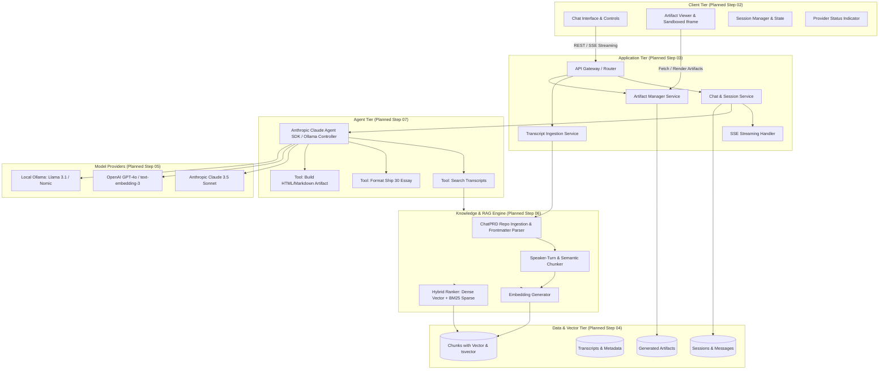
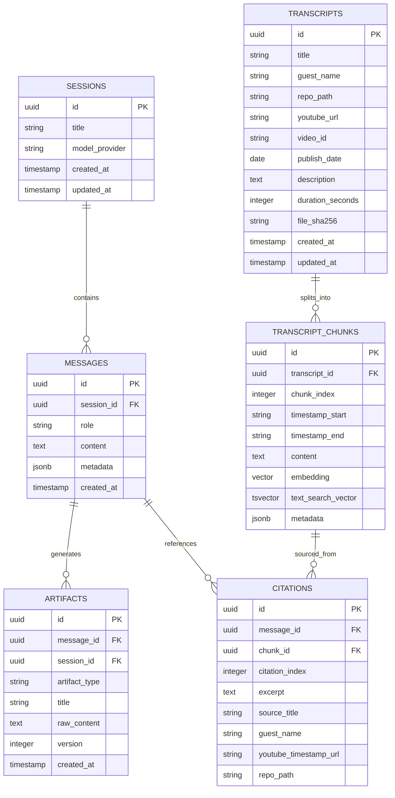

# System Architecture & Technical Specifications
## The Lenny Growth Assistant

**Version:** 1.2.0 (Knowledge-Base & Roadmap Synchronization)  
**Author:** Forward Deployed Engineering Assessment Candidate  
**Status:** In Planning / Design Phase  
**Last Updated:** October 2026

---

> [!NOTE]
> **Architecture Status Note**: This document outlines the planned technical architecture. As of **Step 01 / Step 01A**, no backend services, database migrations, embedding pipelines, or frontend modules have been implemented yet. All retrieval, vector indexing, agent loops, and streaming mechanisms described herein are planned designs to be implemented according to the staged roadmap in Section 7.

---

## 1. High-Level System Architecture (Planned)

The Lenny Growth Assistant is designed as a decoupled, modular system consisting of a **React/TypeScript Frontend**, a **FastAPI Asynchronous Backend**, an **Agent Orchestration Tier (Anthropic Claude Agent SDK / Ollama Adapter)**, a **PostgreSQL + pgvector Database**, and a **Multi-Provider LLM Gateway**.



---

## 2. Evaluation & Selection of Mandatory AI Agent Frameworks

The assessment requires evaluating **Anthropic Claude Agent SDK** and **Pi Coding Agent**.

### 2.1 Comparative Evaluation

| Evaluation Criteria | Anthropic Claude Agent SDK | Pi Coding Agent |
| :--- | :--- | :--- |
| **Primary Domain Focus** | General AI reasoning, conversational agentic workflows, multi-tool orchestration, and knowledge synthesis. | Specialized software engineering, code generation, terminal command execution, and repo refactoring. |
| **Tool Calling & Citations** | Native support for Anthropic tool use, JSON schema validation, and structured output formatting. | Code-execution-first tool schema designed for coding tasks and file-system manipulation. |
| **Cloud Model Support** | Native, first-class integration with Claude 3.5 Sonnet / Claude 3 Opus. | Supports LLMs via terminal and code interfaces. |
| **Local Model Compatibility** | Native SDK requires Anthropic API endpoints. For local Ollama (Step 05), requires standard OpenAI-compatible tool calling bridge or provider router. | Requires local LLM coding tool support. |
| **Suitability for Take-Home Assessment** | **HIGH (Selected)**: Aligns directly with conversational transcript Q&A, Ship 30 essay generation, and artifact generation. | **MODERATE**: Highly capable for code generation, but less suited for conversational RAG podcast synthesis. |

### 2.2 Selected Agent Strategy
* **Primary Agent Framework**: **Anthropic Claude Agent SDK** for cloud inference, prompt caching, tool definition, and response generation.
* **Local Model Compatibility Strategy (Step 05)**: To support local offline models via **Ollama** as required, the agent orchestration layer will expose a unified tool definition schema (Pydantic / JSON Schema). In cloud mode, it passes tools to the Anthropic Claude Agent SDK. In local mode, it routes tool calling to Ollama's OpenAI-compatible tool API.

---

## 3. Knowledge-Base Lifecycle & Ingestion Architecture (Planned for Step 06)

The knowledge base will be constructed from the official repository:  
**`https://github.com/ChatPRD/lennys-podcast-transcripts`**

### 3.1 Planned Ingestion & Grounding Pipeline

```mermaid
flowchart LR
    subgraph 1_Load["1. Load (Step 06)"]
        RepoSource[ChatPRD Git Repository / Local Clone] --> RawMD[Read episodes/{guest}/transcript.md & index/*.md]
    end

    subgraph 2_ParseChunk["2. Parse & Chunk (Step 06)"]
        RawMD --> Frontmatter[Parse YAML Frontmatter: guest, title, youtube_url, etc.]
        Frontmatter --> BodyClean[Segment Dialogue & Speaker Turns]
        BodyClean --> Chunks[500-800 Token Chunks with 100 Token Overlap]
    end

    subgraph 3_Index["3. Index (Step 06)"]
        Chunks --> Dense[Generate Dense Vector Embeddings]
        Chunks --> Sparse[Generate PostgreSQL tsvector BM25]
        Dense & Sparse --> DBStore[(PostgreSQL + pgvector)]
    end

    subgraph 4_Refresh["4. Refresh (Step 06)"]
        FileHash[SHA-256 Checksum Validator] -->|Diff Modified Files| Frontmatter
    end

    subgraph 5_TraceRetrieval["5. Traceable Retrieval (Step 07)"]
        Query[User Query] --> HybridSearch[Dense Vector + BM25 Keyword Search]
        HybridSearch --> RRF[Reciprocal Rank Fusion RRF]
        RRF --> ConfidenceCheck{Similarity >= 0.70?}
        ConfidenceCheck -->|Yes| PromptContext[Inject Chunks with Guest, Title, Video URL & Timestamps]
        ConfidenceCheck -->|No| ExplicitRefusal[Acknowledge Lack of Transcript Coverage]
    end
```

### 3.2 Planned Ingestion Phases (Step 06 Implementation)
1. **Loading**: Reads `episodes/{guest-slug}/transcript.md` and `index/*.md` from the official repository.
2. **Parsing**: Uses `python-frontmatter` / `PyYAML` to parse structured metadata:
   - `guest`, `title`, `youtube_url`, `video_id`, `publish_date`, `description`, `duration_seconds`.
3. **Chunking**: Segments dialogue into 500–800 token chunks preserving speaker turn boundaries and timestamp markers (`[HH:MM:SS]`).
4. **Indexing**: Dense embeddings stored in `pgvector` alongside PostgreSQL full-text search `tsvector` columns.
5. **Incremental Refresh**: Compares file SHA-256 hashes against database records to index only new or updated episodes.
6. **Traceability & Grounding**: Every chunk retains full metadata pointers back to original file path, episode title, and timestamped YouTube link.
7. **Refusal Guardrail**: When similarity score $< 0.70$ or no relevant chunks match, the agent explicitly acknowledges the lack of transcript coverage.

---

## 4. Planned Database Schema (PostgreSQL + pgvector - Step 04)



---

## 5. Planned API Boundaries & Endpoints (FastAPI - Step 03)

All endpoints will be versioned under `/api/v1`.

### 5.1 Chat & Streaming Endpoints (Step 03 / Step 07)
- `POST /api/v1/sessions`: Create new session.
- `GET /api/v1/sessions`: List all sessions.
- `GET /api/v1/sessions/{session_id}/messages`: Retrieve session messages with citations.
- `POST /api/v1/sessions/{session_id}/messages/stream`: SSE streaming endpoint emitting:
  - `event: token`: `{ "delta": "..." }`
  - `event: citation`: `{ "index": 1, "guest": "...", "title": "...", "youtube_url": "...", "repo_path": "...", "timestamp": "...", "excerpt": "..." }`
  - `event: artifact_start`: `{ "artifact_id": "...", "type": "html" | "markdown" | "essay", "title": "..." }`
  - `event: artifact_chunk`: `{ "delta": "..." }`
  - `event: artifact_complete`: `{ "artifact_id": "..." }`
  - `event: done`: `{ "message_id": "...", "finish_reason": "stop" }`

### 5.2 Ingestion & Artifact Endpoints (Step 03 / Step 06)
- `POST /api/v1/ingestion/sync`: Triggers sync from official repository.
- `GET /api/v1/ingestion/status`: Ingestion status and statistics.
- `GET /api/v1/artifacts/{artifact_id}`: Retrieve artifact content.
- `GET /api/v1/artifacts/{artifact_id}/export?format=html|md|txt`: Export artifact file.

---

## 6. Planned Deployment & Infrastructure (Docker Compose - Subsequent Steps)

- **`postgres`**: PostgreSQL 16 with `pgvector` extension.
- **`backend`**: FastAPI Python ASGI service.
- **`frontend`**: React + Vite static bundle served via Nginx.
- **`ollama`** (Optional profile): Local LLM inference server.

---

## 7. Staged Implementation Roadmap

| Step | Milestone | Scope | Status |
| :--- | :--- | :--- | :---: |
| **Step 01** | Project Foundation & Documentation | Initial configs, PRD, architecture, design, README | ✅ **COMPLETE** |
| **Step 01A** | Knowledge-Base Documentation Review | ChatPRD source validation, agent SDK evaluation, roadmap sync | ✅ **COMPLETE** |
| **Step 02** | Frontend Chat Interface & Artifact Viewer | React + Vite + TypeScript + Tailwind, 2-Pane Split Viewer | ✅ **COMPLETE** |
| **Step 03** | FastAPI Backend Foundation | Core API structure, CORS, routing, Pytest suite | ✅ **COMPLETE** |
| **Step 04** | PostgreSQL Persistence & Database Models | SQLAlchemy models (pgvector), Alembic migrations, session/message CRUD | ✅ **COMPLETE** |
| **Step 05 / 06** | Multi-Provider Gateway & UI Integration | Ollama, Anthropic Claude, OpenAI, live status, session switching | ✅ **COMPLETE** |
| **Step 07** | Transcript Ingestion & pgvector RAG Pipeline | ChatPRD loader, YAML frontmatter parser, chunker, embeddings, pgvector retrieval, genuine citations | ✅ **COMPLETE** |
| **Step 08** | Essay & Artifact Generation Pipeline | Ship 30 essays, HTML interactive widgets, Markdown strategy artifacts | ⏳ **NEXT STEP** |
| **Subsequent** | Full Evaluation & Production Deployment | Agent evaluation framework, Docker Compose, production bundling | ⏳ *Planned* |
